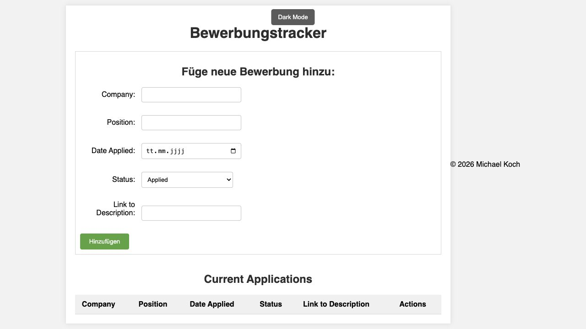

<div align="center">

# Bewerbungstracker

**Bewerbungen organisieren. Den Überblick behalten.**

Eine schlanke Web-App für Unternehmen, Stellen und Bewerbungsstatus.<br>
Ohne Registrierung – die Einträge bleiben im Browser.

**HTML5 · CSS3 · JavaScript · localStorage**

[Funktionen](#funktionen) · [Lokal starten](#lokal-starten) · [Technik](#technik) · [Qualität](#qualität)

</div>

---



*Aktuelle Oberfläche im leeren Startzustand. Lokal aufgenommen am 22. Oktober 2026.*

## Über das Projekt

Welche Bewerbung ist noch offen? Wo steht ein Vorstellungsgespräch an? Der Bewerbungstracker bündelt die wichtigsten Angaben in einer übersichtlichen Tabelle. Einträge lassen sich direkt im Formular bearbeiten und dauerhaft im selben Browser speichern.

Das Projekt setzt auf HTML, CSS und JavaScript ohne Framework oder zusätzliche Pakete. Im Mittelpunkt stehen die Arbeit mit dem DOM, Formularereignisse und die zuverlässige Speicherung strukturierter Daten.

## Funktionen

| Funktion | Was möglich ist |
| --- | --- |
| **Bewerbungen erfassen** | Unternehmen, Position, Bewerbungsdatum und Status speichern |
| **Status verfolgen** | Zwischen Beworben, Vorstellungsgespräch, Angebot und Absage wählen |
| **Stellenanzeige verlinken** | Optional einen HTTP- oder HTTPS-Link hinterlegen |
| **Einträge verwalten** | Bewerbungen bearbeiten, Bearbeitung abbrechen oder Einträge löschen |
| **Lokal speichern** | Bewerbungen und Farbschema beim erneuten Öffnen wieder laden |
| **Darstellung wählen** | Hell- und Dunkelmodus sowie ein Formular für kleine Bildschirme |

## Lokal starten

### 1. Projekt herunterladen

```bash
git clone https://github.com/michkffm/Bewerbungtracker.git
cd Bewerbungtracker
```

Alternativ das Repository auf GitHub über **Code → Download ZIP** herunterladen und entpacken.

### 2. App öffnen

Die Datei `index.html` in einem aktuellen Browser öffnen. Eine Paketinstallation oder ein Build ist nicht erforderlich.

Für eine lokale Vorschau über HTTP mit installiertem Python 3:

```bash
python3 -m http.server 8000 --bind 127.0.0.1
```

Anschließend **[localhost:8000](http://localhost:8000)** öffnen. Mit `Strg+C` wird der Server beendet.

> **Speicherhinweis:** Verwende immer denselben Browser und dieselbe Adresse einschließlich Port. `localhost`, `127.0.0.1` und direkt geöffnete Dateien können unterschiedliche Speicherbereiche verwenden.

## Bedienung

1. **Erfassen:** Unternehmen, Position und Datum eintragen, Status auswählen und auf **Hinzufügen** klicken.
2. **Bearbeiten:** In der Tabelle **Bearbeiten** wählen, Angaben ändern und **Änderungen speichern** anklicken. **Abbrechen** verwirft die ungespeicherten Formulareingaben.
3. **Löschen:** Mit **Löschen** den jeweiligen Eintrag aus der Übersicht und dem lokalen Speicher entfernen.
4. **Farbschema wechseln:** Über **Dunkelmodus** beziehungsweise **Hellmodus** die Darstellung ändern.

## Technik

```text
Bewerbungtracker/
├── index.html          # Formular, Tabelle und Statusmeldungen
├── style.css           # Layout, Farbmodi und mobile Darstellung
├── script.js           # Eingaben, Tabellenaufbau und Speicherung
├── docs/
│   └── screenshot.png  # Vorschau der Oberfläche
└── README.md
```

- **DOM-API:** Tabelleneinträge und Links werden als Elemente erzeugt; Benutzereingaben werden nicht als HTML eingesetzt.
- **Formularverarbeitung:** Ein gemeinsamer Ablauf für neue Einträge und Änderungen verhindert mehrere gleichzeitig aktive Speicheraktionen.
- **localStorage:** Bewerbungen werden als JSON gespeichert und beim Laden auf ihre erwartete Struktur geprüft. Frühere englische Statuswerte bleiben kompatibel.
- **Fehlerbehandlung:** Fehlgeschlagenes Speichern wird angezeigt. Formulareingaben bleiben erhalten. Unlesbare oder unerwartet strukturierte gespeicherte Daten werden nicht automatisch überschrieben.
- **Zugänglichkeit:** Beschriftete Formularfelder, sichtbarer Tastaturfokus, Statusmeldungen für assistive Technologien und Unterstützung für reduzierte Bewegung.

## Daten und Grenzen

Die App selbst übermittelt Bewerbungsdaten an keinen eigenen Server. Die Einträge liegen im `localStorage` des verwendeten Browsers; die App verschlüsselt sie dort nicht zusätzlich.

- Kein Benutzerkonto, kein Backend und keine Datenbank.
- Keine Synchronisation zwischen Geräten und keine Exportfunktion.
- Das Löschen der Website-Daten entfernt auch gespeicherte Bewerbungen. Im privaten Modus können Daten beim Schließen verloren gehen.
- Stellenlinks öffnen externe Websites in einem neuen Tab. Erlaubt sind ausschließlich `http://` und `https://`.
- Beschädigte Browserdaten werden nicht automatisch repariert; Änderungen bleiben zum Schutz der vorhandenen Daten gesperrt.

## Qualität

Die überarbeitete Version wurde am **22. Oktober 2026** mit Chrome automatisiert geprüft.

| Bereich | Geprüfte Abläufe |
| --- | --- |
| Verwaltung | Anlegen, zwischen Bearbeitungen wechseln, Abbrechen und Löschen |
| Speicherung | Neuladen, Farbschema erhalten und fehlgeschlagenes Schreiben |
| Eingaben | Pflichtwerte aus Leerzeichen und unsichere URL-Protokolle |
| Sichere Darstellung | Gespeicherte Links mit HTML-Attributen einschleusen |
| Fehlerfälle | Beschädigtes JSON ohne Überschreiben der Rohdaten |
| Mobile Darstellung | Keine horizontale Überbreite der Seite bei 375 Pixeln |

Diese Prüfungen sowie die JavaScript-Syntaxprüfung und `git diff --check` waren erfolgreich. In den getesteten Abläufen traten keine JavaScript-Fehler auf.

Eine dauerhaft eingerichtete automatisierte Testsuite und eine vollständige Prüfung verschiedener Browser oder der Barrierefreiheit sind nicht enthalten. Eine öffentliche Live-Demo ist nicht verifiziert.

<details>
<summary><strong>Kurzer manueller Funktionstest</strong></summary>

1. Zwei Bewerbungen anlegen und die Seite neu laden: Beide bleiben erhalten.
2. Zuerst den ersten, dann den zweiten Eintrag zum Bearbeiten auswählen: Speichern verändert nur den zweiten.
3. Eine Bearbeitung abbrechen: Der gespeicherte Eintrag bleibt unverändert.
4. Einen Eintrag löschen und neu laden: Er erscheint nicht erneut.
5. Einen HTTPS-Link speichern; einen Link mit `javascript:` eingeben: Der unsichere Link wird abgelehnt.
6. Das Farbschema wechseln und neu laden: Die Auswahl bleibt erhalten.

</details>

## Autor und Lizenz

Entwickelt von **Michael Koch** · [GitHub-Profil](https://github.com/michkffm)

Der Quelltext nennt die MIT-Lizenz. Eine separate `LICENSE`-Datei ist derzeit nicht enthalten.
